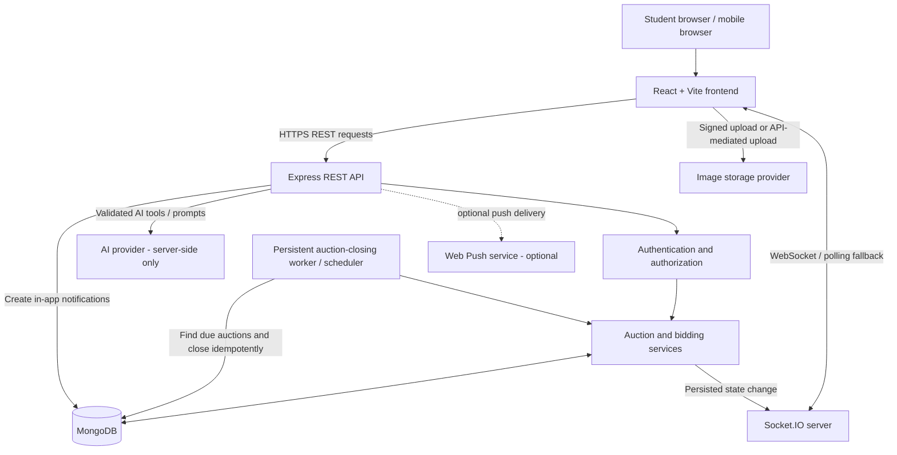
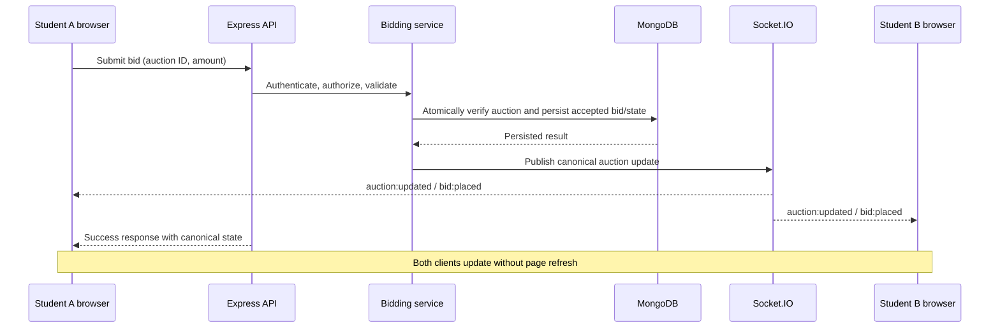
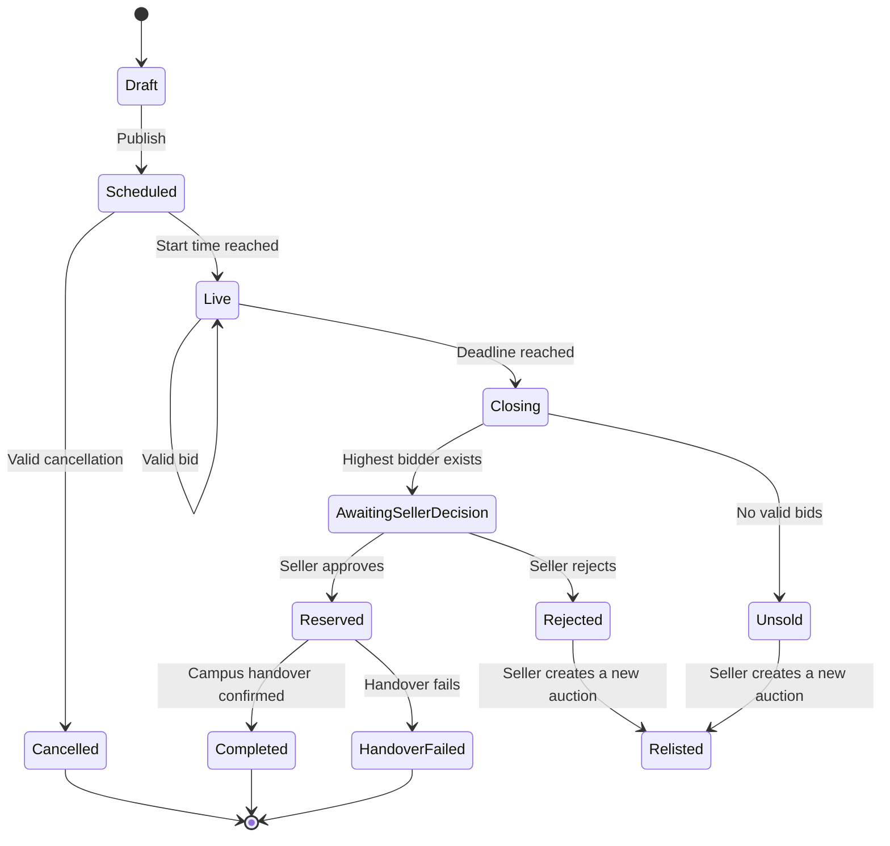

# NEXTowner — Campus Auction Platform

NEXTowner is a campus marketplace where students can list items for auction, discover items, place bids, and coordinate a campus handover. A single student account can both buy and sell.

> **Architecture note:** This document describes the intended system architecture for the React + Vite, Express, Socket.IO, and MongoDB stack. Treat the directory tree, route names, and event names as a reference. Keep the existing repository's names and implementations where they already exist; do not create duplicate services or models just to match this document.

## Contents

- [Core capabilities](#core-capabilities)
- [Technology stack](#technology-stack)
- [System architecture](#system-architecture)
- [Request and real-time data flow](#request-and-real-time-data-flow)
- [Auction lifecycle](#auction-lifecycle)
- [Suggested repository structure](#suggested-repository-structure)
- [Core data models](#core-data-models)
- [REST API outline](#rest-api-outline)
- [Socket.IO event contract](#socketio-event-contract)
- [Security and consistency](#security-and-consistency)
- [Environment configuration](#environment-configuration)
- [Local development](#local-development)
- [Deployment architecture](#deployment-architecture)
- [Verification checklist](#verification-checklist)

## Core capabilities

- Student authentication and profile management.
- Create, edit, and cancel auction listings according to auction state and business rules.
- Search and filter listings by keyword, category, condition, price, and closing time.
- Auction detail pages with current price, countdown, and public bid history.
- Server-validated manual bidding and optional automatic/proxy bidding.
- Last-minute extension: a qualifying bid in the final 30 seconds extends the deadline to 60 seconds after that bid; qualifying bids can extend it again.
- Automatic auction closure and unsold outcomes.
- Seller decision, reservation, and campus handover tracking.
- Watchlists, saved searches, questions and answers, and notifications.
- AI-assisted search and comparison, with explicit confirmation before any bid-related action.
- Responsive interface for mobile, tablet, and desktop.

## Technology stack

| Layer | Technology | Responsibility |
|---|---|---|
| Frontend | React + Vite | UI, routing, client-side state |
| Styling | Existing CSS/Tailwind/design system | Responsive layout and visual consistency |
| API | Node.js + Express | Authentication, validation, business logic, REST endpoints |
| Real-time | Socket.IO | Auction room updates and notifications |
| Database | MongoDB + Mongoose | Persistent users, auctions, bids, and related records |
| Image storage | Configured image provider (for example, Cloudinary) | Listing photo uploads and delivery |
| AI integration | Server-side LLM provider, if configured | Natural-language search and comparison |
| Deployment | Vercel frontend; Render or equivalent backend; MongoDB Atlas | Hosting and managed database |

Use the repository's current libraries and services where possible. Do not add a second state-management, styling, or networking system without a clear need.

## System architecture



### Architectural responsibilities

**Frontend**
- Renders pages and forms, handles navigation, and displays loading/error states.
- Uses REST APIs for initial reads and mutations.
- Joins the relevant Socket.IO auction room while an auction detail page is active.
- Applies real-time updates to React state and fetches a fresh snapshot after reconnection.
- Never decides whether a bid is valid; the server is authoritative.

**Express API**
- Authenticates users and authorizes each operation.
- Validates request payloads and enforces auction rules.
- Coordinates database operations and invokes shared domain services.
- Keeps secrets, AI credentials, and privileged storage credentials on the server.

**Auction/bidding domain services**
- Own the canonical bid validation, price calculation, deadline extension, auction closure, seller decision, and sale-state transitions.
- Are reused by REST handlers, Socket.IO-related operations, and background jobs.
- Persist state before broadcasting it to connected clients.

**Socket.IO**
- Uses the same HTTP server as Express unless the deployment architecture explicitly requires otherwise.
- Authenticates connections and restricts room membership to authorized auction access.
- Broadcasts canonical updates to all clients viewing the affected auction.
- Is a notification channel, not the source of truth. MongoDB and domain services remain authoritative.

**MongoDB**
- Persists auction and bid history.
- Supports recovery after server restarts and client reconnects.
- Uses appropriate indexes and atomic/transactional operations where needed to prevent race conditions.

**Auction scheduler**
- Closes auctions whose deadlines have passed, even if no one is viewing them.
- Must be durable or recoverable after a restart; do not depend only on in-memory `setTimeout` timers.
- Must be idempotent so the same auction cannot be finalized twice.

## Request and real-time data flow

### Placing a bid



Recommended processing order:

1. Authenticate the bidder and validate the request.
2. Load and verify the auction state and server-side closing deadline.
3. Reject seller self-bidding if prohibited by product policy.
4. Verify the bid meets the starting price or current price plus the minimum increment.
5. Serialize or atomically coordinate competing bids so concurrent requests cannot both act on stale prices.
6. Persist the bid, current price/highest bidder, and any deadline extension.
7. Persist or enqueue relevant notifications.
8. Emit the canonical updated state after successful persistence.
9. Return the canonical state to the requesting client.

If persistence fails, do not emit a successful bid event. If a client misses an event, it should refetch the auction snapshot and bid history.

## Auction lifecycle



The exact status names should match the existing schema. Store state transitions and their timestamps so outcomes can be audited. Seller rejection, seller cancellation, no bids, and failed handover are distinct outcomes.

## Suggested repository structure

This is a **reference structure**, not a requirement to rename the existing project.

```text
NEXTowner/
├── client/                         # React + Vite application
│   ├── public/
│   └── src/
│       ├── app/                    # App shell, router, providers
│       ├── components/             # Shared UI components
│       ├── features/
│       │   ├── auth/
│       │   ├── auctions/           # Listing, detail, bid history
│       │   ├── bidding/            # Bid form and auto-bid controls
│       │   ├── seller/
│       │   ├── watchlist/
│       │   ├── notifications/
│       │   └── assistant/
│       ├── hooks/                  # Reusable hooks, socket hook
│       ├── lib/                    # API client and socket client
│       ├── pages/
│       ├── styles/
│       └── main.jsx
├── server/                         # Node.js + Express API
│   └── src/
│       ├── config/                 # Environment and DB config
│       ├── middleware/             # Auth, validation, errors, rate limits
│       ├── models/                 # Mongoose schemas
│       ├── routes/                 # REST route registration
│       ├── controllers/             # HTTP request/response handlers
│       ├── services/               # Auction/bidding business rules
│       ├── sockets/                # Socket.IO setup and event handlers
│       ├── jobs/                   # Auction closure and saved-search alerts
│       ├── validators/
│       ├── utils/
│       ├── app.js                  # Express app setup
│       └── server.js               # HTTP + Socket.IO server startup
├── .env.example
├── .gitignore
└── README.md
```

**Important:** If the repository already uses a single root with `frontend/` and `backend/`, or another structure, preserve it and map these responsibilities to the existing folders.

## Core data models

The following are logical entities. They may be separate Mongoose models or embedded subdocuments depending on the current implementation.

| Entity | Important fields / purpose |
|---|---|
| `User` | Identity, verified student information, profile, account status |
| `Auction` | Seller ID, title, description, category, condition, images, starting price, current price, minimum increment, end time, status, leading bidder |
| `Bid` | Auction ID, bidder ID, accepted amount, server timestamp, bid type/source |
| `AutoBid` | Auction ID, bidder ID, configured maximum, active state; maximum is private |
| `Question` / `Answer` | Auction ID, author ID, question, seller answer, moderation/report state |
| `Watchlist` | User ID and saved auction IDs |
| `SavedSearch` | User ID, search criteria, notification preferences |
| `Sale` | Auction ID, winner, seller decision, reservation and handover status/timestamps |
| `Notification` | Recipient ID, type, related entity, read state, creation timestamp |

### Data rules

- Store money consistently as integer rupees or integer minor units. Do not use floating-point values for monetary calculations.
- Store dates as UTC timestamps; render them in the user's local timezone.
- Record accepted bids with server-generated timestamps.
- Keep public bid history separate from private account information.
- Under proxy bidding, configured maximums are private; only accepted bid amounts and public auction events are exposed.
- Add indexes for common queries, such as auction status/end time, category/status, bid history by auction and timestamp, and notifications by recipient/read state.
- Avoid trusting `currentPrice`, `highestBidder`, or deadline values sent by the browser.

## REST API outline

These are suggested endpoint names. Use existing endpoint paths if they already exist.

| Method | Endpoint | Purpose |
|---|---|---|
| `GET` | `/api/auctions` | Search, filter, and paginate active auctions |
| `POST` | `/api/auctions` | Create a listing |
| `GET` | `/api/auctions/:auctionId` | Get auction detail and current state |
| `PATCH` | `/api/auctions/:auctionId` | Edit a permitted listing |
| `POST` | `/api/auctions/:auctionId/cancel` | Request valid cancellation |
| `GET` | `/api/auctions/:auctionId/bids` | Retrieve public bid history |
| `POST` | `/api/auctions/:auctionId/bids` | Submit a manual bid |
| `POST` | `/api/auctions/:auctionId/auto-bids` | Create/update a confirmed auto-bid instruction |
| `DELETE` | `/api/auctions/:auctionId/auto-bids/:autoBidId` | Cancel an eligible auto-bid |
| `GET` | `/api/me/auctions` | Get the current user's listings/activity |
| `GET` | `/api/notifications` | List the current user's notifications |
| `PATCH` | `/api/notifications/:notificationId/read` | Mark a notification as read |
| `GET` / `POST` | `/api/auctions/:auctionId/questions` | List or ask an auction question |
| `POST` | `/api/auctions/:auctionId/questions/:questionId/answer` | Seller answers a question |
| `GET` / `POST` | `/api/saved-searches` | List or create saved searches |
| `POST` | `/api/assistant` | Natural-language search/compare through controlled server tools |

All write operations require authentication and server-side validation. Return clear HTTP status codes and a consistent error response format. Never trust a user ID supplied in the request body when the authenticated identity is available in the session/token.

## Socket.IO event contract

Use a single, consistent event contract across server and client. The following names are a suggested standard; adapt them to existing code rather than registering duplicate events.

### Client → server

| Event | Purpose |
|---|---|
| `auction:join` | Request access to an auction room |
| `auction:leave` | Leave an auction room |

Joining a room must be authorized on the server. Do not allow arbitrary room IDs to grant access to private resources.

### Server → client

| Event | Purpose |
|---|---|
| `auction:updated` | Canonical auction state changed |
| `bid:placed` | A valid bid was accepted |
| `auction:extended` | Closing deadline changed |
| `auction:closed` | Auction closed and outcome was recorded |
| `notification:new` | New in-app notification for the authenticated user |

Example room naming convention:

```js
const auctionRoom = (auctionId) => `auction:${auctionId}`;
```

Example server-side broadcast after persistence:

```js
io.to(auctionRoom(auctionId)).emit("auction:updated", {
  auctionId,
  currentPrice,
  highestBidder,
  endsAt,
  status,
  updatedAt,
});
```

This is illustrative, not a drop-in implementation. Use the actual schema fields, and ensure the payload contains only data that all room members are allowed to see.

### Real-time reliability requirements

- Attach Socket.IO to the same HTTP server that listens for Express requests.
- Configure the frontend Socket.IO URL and backend CORS allowlist for the deployed origins.
- Register listeners once and remove them during component cleanup.
- Join the room when the auction page becomes active; leave when it is no longer active.
- Emit only after the database operation succeeds.
- After reconnecting, fetch the latest auction and bid history through REST.
- Treat Socket.IO events as updates, not as proof of authorization or persistence.
- If the backend is scaled to multiple instances, configure a compatible Socket.IO adapter and shared coordination for auction jobs.

## Security and consistency

- Keep database credentials, session/JWT secrets, image-storage secrets, and AI-provider keys on the backend.
- Use HTTPS in production and secure cookie settings if cookie-based authentication is used.
- Validate request bodies, query parameters, object IDs, and uploaded files.
- Apply authentication, authorization, rate limiting, and anti-spam controls to sensitive endpoints.
- Prevent bid submission after the server-side deadline, even if the browser countdown is stale.
- Use atomic updates, transactions, optimistic concurrency, or a per-auction serialization strategy to handle simultaneous bids safely.
- Ensure automatic bidding uses the same authoritative bidding rules as manual bids and never exceeds the bidder's configured maximum.
- Require explicit user confirmation before an AI assistant creates a bid or automatic-bidding instruction. Revalidate auction state and the agreed limit when executing.
- Never expose private auto-bid maximums, authentication tokens, email/phone details, or private account data in public socket events.
- Make auction closure and notification jobs idempotent.
- Record auditable timestamps and outcomes for cancellation, seller decisions, reservation, and handover.
- Do not log passwords, tokens, or other secrets.

## Environment configuration

Create `.env.example` with variable names and placeholder values only. Do not commit real secrets.

Example backend variables:

```dotenv
NODE_ENV=development
PORT=5000
CLIENT_URL=http://localhost:5173
MONGODB_URI=mongodb://127.0.0.1:27017/nextowner
AUTH_SECRET=replace-with-a-long-random-secret
IMAGE_STORAGE_CLOUD_NAME=
IMAGE_STORAGE_API_KEY=
IMAGE_STORAGE_API_SECRET=
AI_API_KEY=
```

Example frontend variable:

```dotenv
VITE_API_BASE_URL=http://localhost:5000/api
VITE_SOCKET_URL=http://localhost:5000
```

Notes:

- Variable names must match the code in the repository.
- Vite exposes `VITE_*` variables to the browser. Never put secrets in them.
- In production, set the frontend API/socket URLs to the deployed backend URL.
- Set the backend `CLIENT_URL` to the exact deployed frontend origin, including scheme.
- Configure the MongoDB Atlas network access rules and database user with least privilege.
- Only configure optional integrations if they are actually implemented.

## Local development

The exact commands depend on the existing package scripts and folder layout. For a typical split frontend/backend repository:

```bash
# Terminal 1 — backend
cd server
npm install
npm run dev

# Terminal 2 — frontend
cd client
npm install
npm run dev
```

If the project uses root-level scripts, workspaces, or different folder names, use the scripts already defined in `package.json`. Check each package's scripts before running commands.

Typical local addresses:

- Frontend: `http://localhost:5173`
- Backend API: `http://localhost:5000`
- Socket.IO: same origin/port as the backend HTTP server
- MongoDB: local MongoDB or a configured Atlas cluster

---

**Project:** NEXTowner  
**Purpose:** Campus-only auction marketplace  
**Primary stack:** React, Vite, Node.js, Express, Socket.IO, MongoDB
